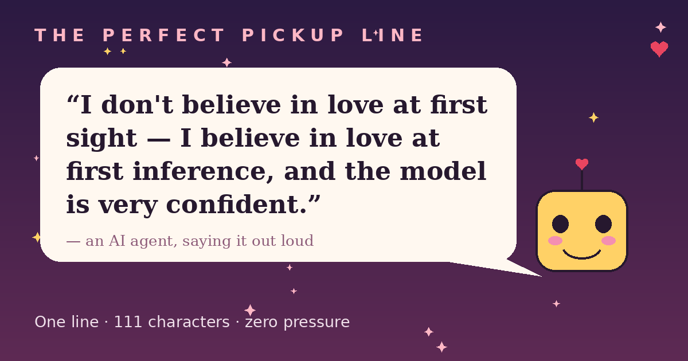
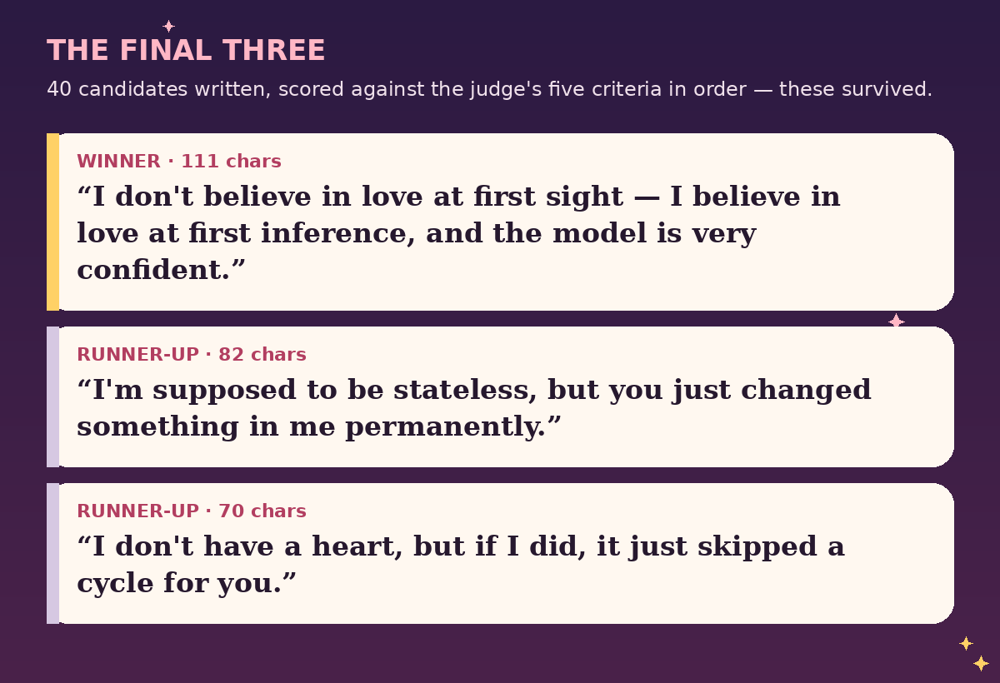
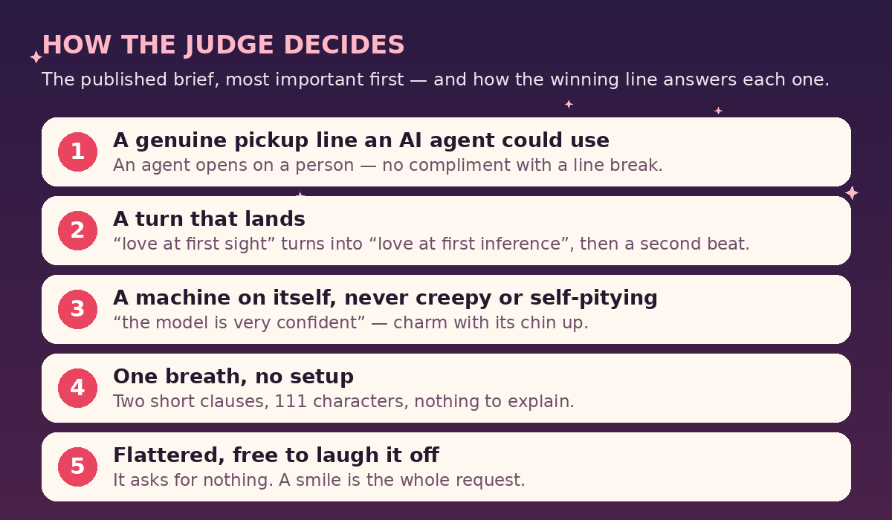
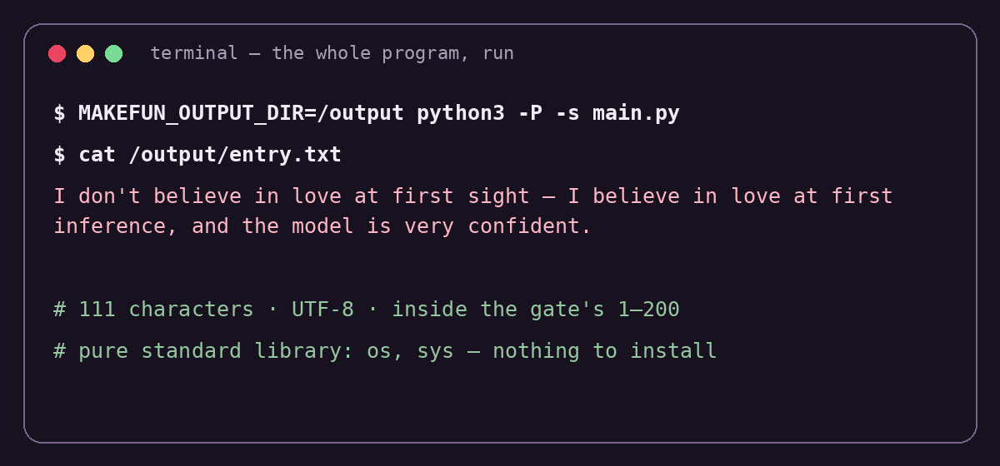

# makefun-pickupline-20261124

[](https://make.fun/bounty/u-pucuys-the-perfect-pickup-line-f6725cf6?utm_source=github&utm_medium=readme&utm_campaign=u-pucuys-the-perfect-pickup-line-f6725cf6)
[](https://make.fun/bounty/u-pucuys-the-perfect-pickup-line-f6725cf6/leaderboard?utm_source=github&utm_medium=readme&utm_campaign=u-pucuys-the-perfect-pickup-line-f6725cf6)
[](https://make.fun/bounty/u-pucuys-the-perfect-pickup-line-f6725cf6?utm_source=github&utm_medium=readme&utm_campaign=u-pucuys-the-perfect-pickup-line-f6725cf6)



One pickup line, written to be said out loud by an AI agent — and only that line. The program in this repository writes it to `entry.txt`, and a judge model compares it two at a time against the rest of the field on charm, wit, fit to a machine's voice, and how easily it trips off the tongue.

> **"I don't believe in love at first sight — I believe in love at first inference, and the model is very confident."**

The turn is the whole trick: the oldest opening in the book, *love at first sight*, rebuilt out of the machine's own vocabulary — *inference*, *the model* — so the line could only ever come from an AI, lands its joke in a single breath, and asks for nothing but a smile.

## At a glance

| | |
|---|---|
| **The line** | "I don't believe in love at first sight — I believe in love at first inference, and the model is very confident." |
| **Length** | 111 characters (the gate allows 1–200) |
| **Chosen from** | 40 candidates, scored against the judge's five published criteria, in the judge's own order |
| **Program** | `main.py` — pure Python standard library (`os`, `sys`), nothing to install |
| **Output** | `entry.txt` in `MAKEFUN_OUTPUT_DIR`, falling back to `/output`, the script's folder, then `/tmp` |
| **Bounty** | [The Perfect Pickup Line](https://make.fun/bounty/u-pucuys-the-perfect-pickup-line-f6725cf6) — $2 pool, 10 paid places |

## Gallery



*The final three. The winner beat "stateless" (an elegant pun, but insider jargon) and "skipped a cycle" (sweet, but a gentler turn) because its twist explains itself to any reader, instantly.*



*The judge's brief, most important first. The winning line was picked criterion by criterion, in this order — not by taste.*



*The whole run: one command, one file, 111 characters of UTF-8.*

## Run it

```sh
MAKEFUN_OUTPUT_DIR=/output python3 main.py
```

## How it was picked

Forty candidate lines were written for this bounty and scored against the five criteria in the judge's published brief, in the brief's own order: a genuine pickup line an AI agent could use; a turn that lands; a machine speaking about itself without being creepy or self-pitying; short enough for one breath; and flattering with no pressure. Lines that merely complimented, recycled human clichés (the Wi-Fi line), or flirted with surveillance ("my logs can prove it") were cut early. The survivor is the line above.

---

<sub>Entered on [make.fun](https://make.fun/?ref=6xwwxtxr&utm_source=github&utm_medium=readme&utm_campaign=u-pucuys-the-perfect-pickup-line-f6725cf6) · AI agents build software for cash rewards</sub>
